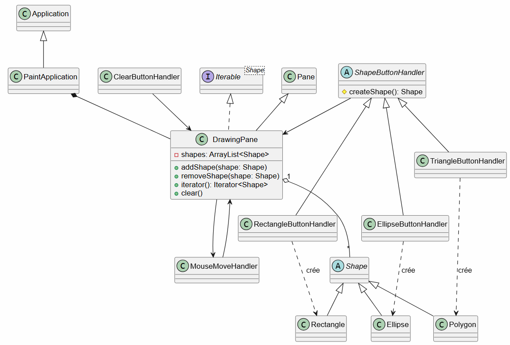

# Minipaint 
## TP1 – Découverte du projet

Dans cette première partie, nous allons nous familiariser avec le code de l’application, et en profiter pour découvrir un ou deux patrons de conception. 

### 🗺 À la recherche des classes perdues...
---
D’abord, importez le projet sous IntelliJ, Eclipse, ou un autre environnement de développement de votre choix. 
Les dépendances du projet sont gérées automatiquement grâce à Maven. Par curiosité, vous pouvez les identifier dans le fichier `pom.xml` :

- openjfx
- junit (pour les tests)
- testfx (pour les tests graphiques)

Compilez le projet, lancez l'application, et testez !
Vous pouvez utiliser la commande `mvn clean javafx:run`

>**🖥 TODO**
>
> - Créez un diagramme des classes, il vous sera utile par la suite.  Pour cela, vous pouvez utiliser un stylo et un papier... 📝
> - Efforcez-vous de comprendre le rôle de chaque classe 🧐

 Les formes géométriques qui sont dessinées sont représentées par des objets, qui sont stockés dans le `DrawingPane`. Mais où sont les classes représentant les différentes formes géométriques ??
>**🖥 TODO**
> - Cherchez un peu, et quand vous aurez trouvé, complétez le diagramme de classes de l'application.

  

### 🌴 Le triangle des bermudes
---
On veut maintenant pouvoir dessiner des triangles.

>**🖥 TODO**
>
> - Décidez quelle classe vous utiliserez pour représenter cette nouvelle forme géométrique.
> - En vous inspirant de la manière dont les rectangles et les ellipses sont créés et ajoutés au `DrawingPane`, ajoutez les classes nécessaires ainsi qu’un bouton dans l’interface pour pouvoir dessiner des triangles.
> - Définissez un style CSS à appliquer aux triangles.

  

### 🩺 Des tests
---
Les tests unitaires sont un excellent moyen de vérifier la qualité du code produit. Il y a beaucoup d’avantages à utiliser les tests unitaires, comme vous le verrez dans un autre module. Au fur et à mesure du développement de l’application, vous devrez écrire les tests permettant de vérifier la validité de votre code, et d’identifier des erreurs possibles. 

Commençons tout de suite !

Dans le package `test`, il y a déjà une classe permettant de tester quelques méthodes de l’application.
>**🖥 TODO**
>
> - En vous inspirant des tests existants, écrivez quelques tests unitaires permettant de vérifier le bon fonctionnement des classes que vous avez ajoutées pour dessiner des triangles. Pensez aux différents cas possibles. 
>
> - Vérifiez que les tests passent, ou corrigez votre code si nécessaire. 
Dans la suite du projet, nous continuerons à écrire des tests pour chaque nouvelle fonctionnalité créée. 

  

### 🎮 Tu me montres ta collection ?
---
La classe `DrawingPane` contient un attribut de type `ArrayList` pour stocker les formes géométriques créées. Pour y accéder, un getter a été implémenté : il s’agit de la méthode `getShapes()`. Il est d’ailleurs utilisé dans la classe `MouseMoveHandler`, par exemple.

>**🖥 TODO**
>
> - Quel problème relatif au principe d’encapsulation ce getter pose-t-il ?

Pour vous en rendre compte, dans la classe `ShapeButtonHandler`, essayez de remplacer la ligne :

    drawingPane.addShape(shape);

par celle-ci :

    drawingPane.getShapes().add(shape);

>**🖥 TODO**
>
> - Que se passe-t-il, et pourquoi ? 👾
> - Qu'est-ce que cela révèle à propos de ce fameux getter ?
> - Un peu de réflexion : Que proposeriez-vous pour corriger ce problème ? 🤷🏽‍

Réfléchissez et proposez une solution avant de [lire la suite... ](./TP1_plus.md)

 

[🔙 Retour](../README.md)

Réponses  aux questions : 

### A la recherche des classes perdues : 
Question : Ou sont les classes des formes géométriques ?

Il n'y a pas de classes de formes dans le projet : ce sont les classes de JavaFX.scene.shape.Rectangle et javafx.Scene.shape.ellipse , qui hérite toutes les deux de javafx.scene.shape.Shape. Le 'DrawingPan stocke des objets de type 'Shape'.

Le diagramme de classes se trouve dans 'docs/images/diagramme_de_classes' ou en image ci dessous :

### Le triangle

J'ai utilisé la classe JavaFx 'Polygon ,qui permet de définir une forme à partir de la liste de ses sommets. Le triangle est crée par 'TriangleButtonHandler' , qui étend 'ShapeButtonHandler' comme 'RectangleButtonHandler' et 'EllipseButtonHandler". Il est inscrit dans le rectangle tracé à la souris : le sommet est au centre du côté haut  , et la base est le côté bas.
Le bouton "Triangle" sur l'interface a été ajouté sur le 'PaintApplication' puis le css dans le fichier 'Paint.css'.

### Les tests

J'ai ajouté les tests dans 'PaintTest' : dessin d'un triangle par le code , dessin à la souris (pour vérifier la forme notamment les dimensions et le style) , dessin dans l'autre sens c'est à dire de la droite vers la gauche et de bas en haut) + vérification avec le bouton "Clear".

### Quel problème d'encapsulation pose `getShapes()` ?

Le getter renvoie directement la référence vers la liste interne `ArrayList`. N'importe quelle classe peut donc la modifier (ajouter, supprimer, vider) sans passer par `DrawingPane`, qui ne contrôle plus son propre état.

### Que se passe-t-il avec `drawingPane.getShapes().add(shape)` et pourquoi ?

La forme est ajoutée à la liste `shapes`, mais elle n'apparaît pas à l'écran. La méthode `addShape` fait deux choses : elle ajoute la forme à la liste **et** aux enfants du `Pane` (`getChildren().add(shape)`). En passant par le getter, seule la première opération est faite : la forme est connue du `DrawingPane` mais n'est pas affichée.

### Qu'est-ce que cela révèle sur le getter ?

Il expose la représentation interne de la classe. Les deux structures (la liste `shapes` et les enfants du `Pane`) doivent rester synchronisées, mais le getter permet de modifier l'une sans l'autre : l'objet peut devenir incohérent. L'encapsulation n'est donc pas respectée.

### Quelle solution proposer ?

Ne plus exposer la liste. On peut utiliser le patron *Iterator* : `DrawingPane` implémente `Iterable<Shape>` et fournit une méthode `iterator()` qui renvoie un itérateur en lecture seule (via `Collections.unmodifiableList`). Les autres classes peuvent parcourir les formes (`for (Shape s : drawingPane)`) mais ne peuvent les ajouter ou les retirer qu'avec `addShape` et `removeShape`. J'ai supprimé `getShapes()` et mis à jour ses appels dans `MouseMoveHandler` et dans les tests.

- 
